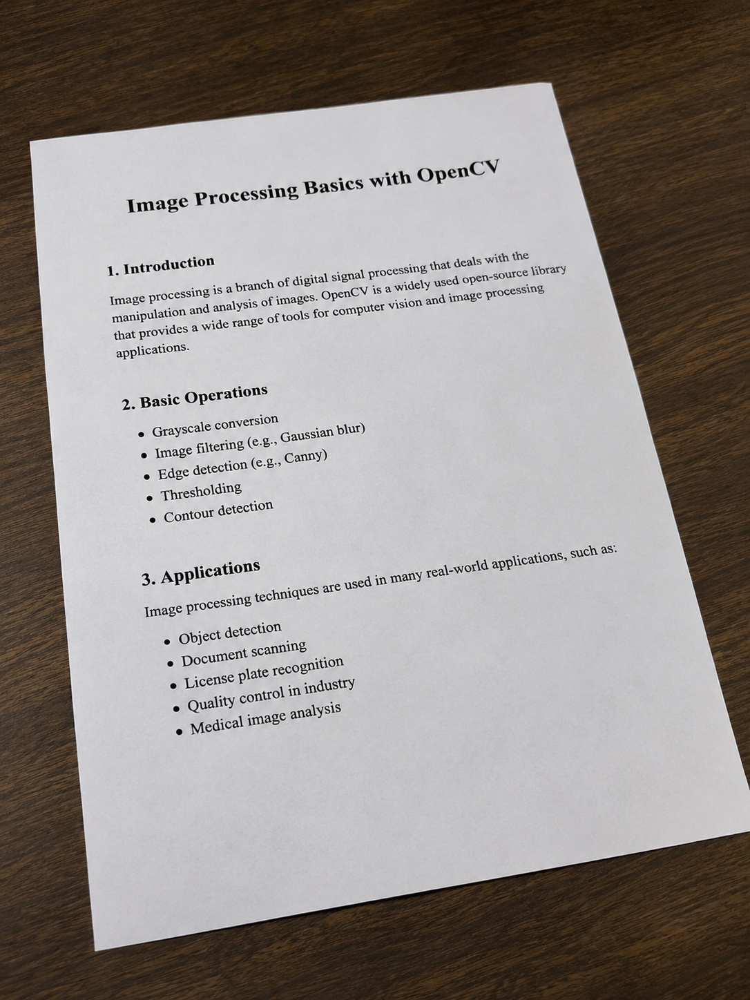
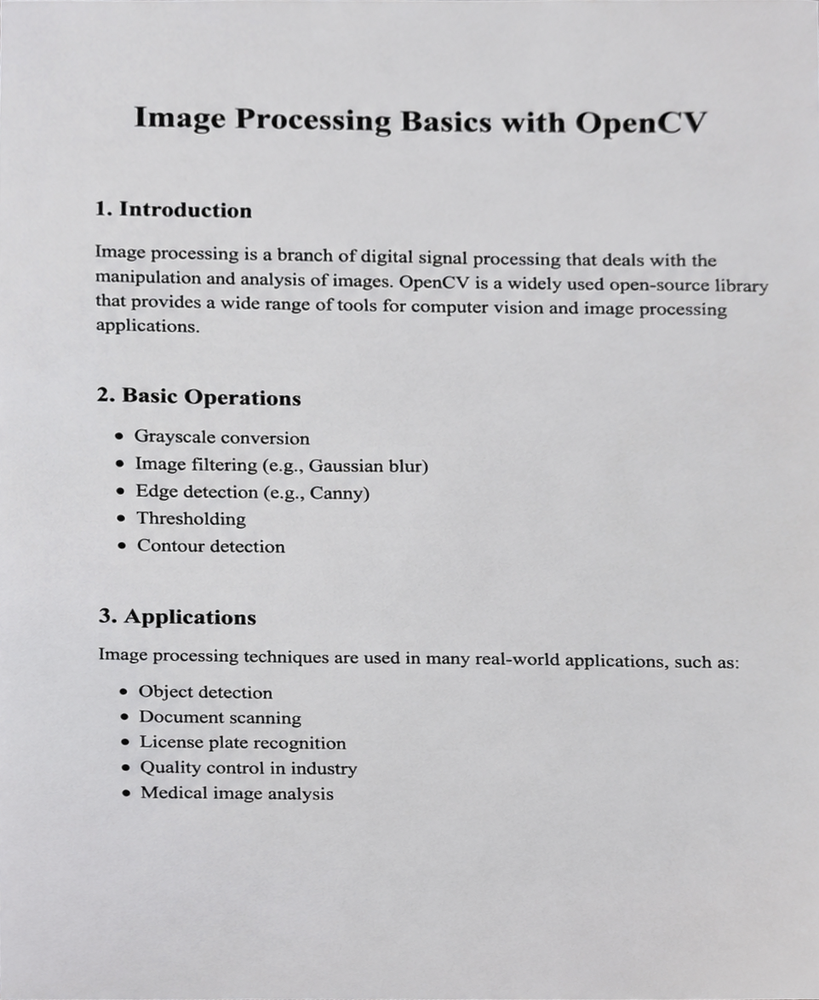
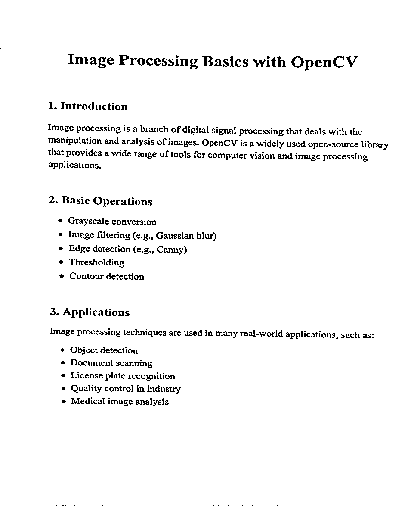

# OpenCV Document Scanner

[Open the notebook in Google Colab](https://colab.research.google.com/github/gizemnurbektas/opencv-document-scanner/blob/main/document_scanner.ipynb)

This project turns a photographed document into a perspective-corrected image and a high-contrast black-and-white scan using OpenCV.

## Example input



## Results

**Perspective corrected**



**Scanned document**



## Processing steps

1. Upload a document photo in Colab.
2. Convert it to grayscale and apply Gaussian blur.
3. Apply Otsu thresholding and morphological closing to locate the page outline.
4. Approximate the largest contour as four corners.
5. Apply a perspective transform to flatten the page.
6. Apply adaptive Gaussian thresholding to produce the scan.

## Run the notebook

Open [document_scanner.ipynb](document_scanner.ipynb) in Google Colab and run the cells from top to bottom. Upload a document image when prompted. The notebook saves the processed images in the Colab runtime.

## Run locally

Install the image-processing dependencies:

```bash
pip install opencv-python numpy matplotlib
```

The upload cell uses the Colab API. To run locally, replace it with an image path such as:

```python
img = cv2.imread("images/original_document.jpg")
if img is None:
    raise FileNotFoundError("Could not read the input image")
original = img.copy()
```

The contour-based method works best when the document boundary is clearly visible against its background.

## Project structure

```text
opencv-document-scanner/
├── document_scanner.ipynb
├── images/
│   └── original_document.jpg
├── results/
│   ├── perspective_corrected.png
│   └── scanned_document.png
├── README.md
├── .gitignore
└── LICENSE
```

## License

Released under the MIT License. See [LICENSE](LICENSE).
